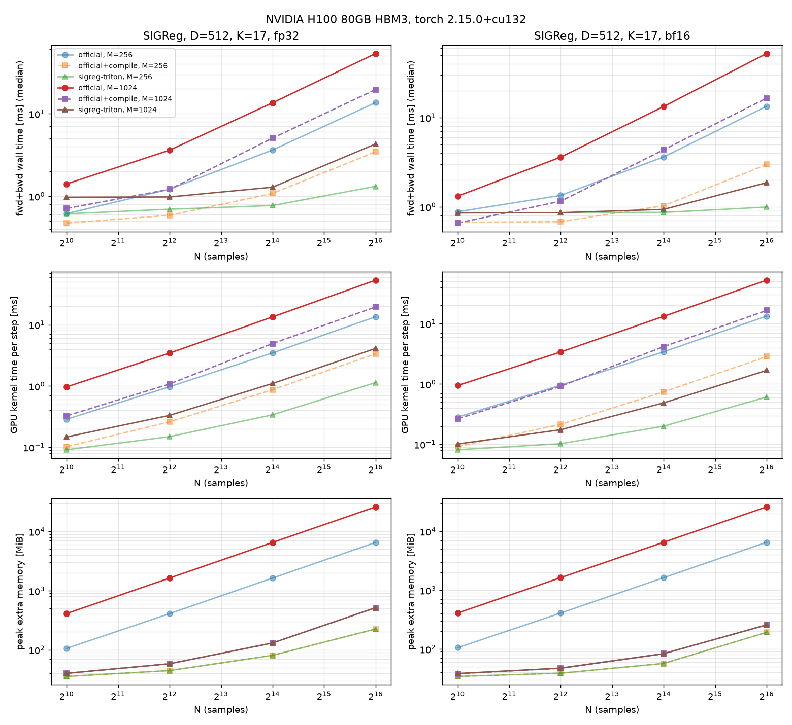

# sigreg-triton

Fused Triton forward and backward kernels for **SIGReg**, the regularizer of LeJEPA, with a
drop-in API for the official implementation.

SIGReg (Sketched Isotropic Gaussian Regularization) pushes the distribution of embeddings
towards an isotropic Gaussian. It projects the embeddings onto random unit directions and,
for each 1-D projection, measures the Epps-Pulley statistic: a weighted L2 distance between
the empirical characteristic function and that of N(0, 1), integrated with a quadrature rule
(Balestriero and LeCun, [arXiv:2511.08544](https://arxiv.org/abs/2511.08544)).

## Why a kernel

For embeddings `Z` (N x D), M directions and K integration knots, the official PyTorch code
materializes `x * t` with shape N x M x K, its cosine and sine, and keeps `x * t` for the
backward. At N = 16384, M = 1024, K = 17 in float32 that is 1.06 GiB per tensor.

`sigreg-triton` keeps the projection `x = Z @ A` in cuBLAS and fuses everything that follows
it into one Triton kernel, plus one recomputing backward kernel:

* one accurate `cos`/`sin` of `theta = dt * x` per element; `cos`/`sin(k * theta)` for the
  next knots come from angle addition (a complex rotation, 4 FMAs per knot);
* the reduction over N happens in registers (one tile-shaped accumulator per knot), with
  per-chunk partial sums added in a fixed order: results are deterministic, no atomics;
* the backward saves only `x` (N x M) and recomputes the phases;
* knots are processed in register-resident groups of at most 17 (larger groups spill).

Only the M x K empirical CF leaves the kernel. The quadrature, the distributed all-reduce and
the `N * world_size` scaling stay in PyTorch with the official semantics.

Why not fuse the projection as well: see [Design notes](#design-notes).

## Install

```bash
pip install -e .            # needs torch; Triton ships with the CUDA builds of torch
pip install -e ".[dev]"     # + pytest, ruff
```

On CPU, or without Triton, everything runs through the pure-PyTorch reference.

## Usage

```python
import torch
from sigreg_triton import SIGReg, EppsPulley, sigreg

z = torch.randn(4096, 512, device="cuda", requires_grad=True)

# Module, drop-in for
# lejepa.multivariate.SlicingUnivariateTest(lejepa.univariate.EppsPulley(), num_slices=1024)
loss_fn = SIGReg(num_slices=1024).cuda()  # t_max=3.0, n_points=17, reduction="mean"
loss = loss_fn(z)  # re-samples directions from loss_fn.global_step, then increments it
loss.backward()

# Functional form with an explicit seed or explicit directions
loss = sigreg(z, num_slices=1024, global_step=0)

# Univariate test only, usable inside the official SlicingUnivariateTest
stats = EppsPulley().cuda()(z @ torch.randn(512, 64, device="cuda"))  # -> (64,)
```

`backend="auto"` (default) uses the Triton kernel for CUDA float32/float16/bfloat16 tensors
and the PyTorch reference otherwise; `"triton"` and `"torch"` force one of them.

## Definition and compatibility

The implementation follows the official code at
[galilai-group/lejepa@c293d29](https://github.com/galilai-group/lejepa/tree/c293d291ca87cd4fddee9d3fffe4e914c7272052)
(`EppsPulley` and `SlicingUnivariateTest`):

* knots `t_k = k * t_max / (K - 1)`, `k = 0..K-1`, on `[0, t_max]`;
* weights: trapezoid weights, doubled for the implicit `t < 0` half (the integrand is
  even), times the Gaussian window `exp(-t^2 / 2)`;
* statistic per direction:
  `N * world_size * sum_k w_k ((mean cos(t_k x) - exp(-t_k^2/2))^2 + (mean sin(t_k x))^2)`;
* distributed training: the mean cos/sin are averaged across ranks with the differentiable
  `torch.distributed.nn.all_reduce` (on backends without `AVG`, e.g. gloo, `SUM / W`, which
  has the same value and gradient); `global_step` is synchronized with an all-reduce MAX;
* directions: `torch.randn((D, M))` from a `torch.Generator` on the input's device seeded
  with `global_step`, columns normalized to unit L2 norm; for the same `global_step` they are
  bit-identical to the official ones;
* `reduction` in `{"mean", "sum", None}` and `clip_value` as in the official module.

**Defaults.** The paper's listing integrates over `[-5, 5]` with 17 knots and `torch.trapz`,
while the official package defaults to `t_max=3, n_points=17` on the folded half-line. Both
are the same family: the trapezoid rule on the symmetric grid with `2K - 1` knots equals the
folded rule with doubled weights, so the paper's listing is exactly `t_max=5, n_points=9`
here (checked in `tests/test_reference.py`). The defaults follow the official package
(`t_max=3, n_points=17`), which is the code the paper refers to for its symmetric
quadrature, and this keeps the module a drop-in replacement. `num_slices` defaults to 1024,
the paper's recommended starting point.

Small deviations: a `float64` input uses a float64 grid (the official module needs
`.double()`); outside autocast, directions are cast to the input dtype (the official module
raises on bfloat16 inputs outside autocast). Under autocast both give the same result.

## Benchmarks

Setup: one NVIDIA H100 80GB HBM3 (driver 610.43.02), PyTorch 2.15.0+cu132 (CUDA 13.2),
Triton 3.9.0, Python 3.12.3, official package at commit `c293d29`, TF32 matmul disabled
(PyTorch default). Full data in `results/bench.csv`, environment in `results/env.json`.

What is measured, per configuration: one forward+backward of the whole module (direction
sampling, projection, statistic, mean over slices) from embeddings `z` (N x D,
`requires_grad`), for

* **official**: `SlicingUnivariateTest(EppsPulley(t_max=3, n_points=K), num_slices=M)`, eager;
* **compile**: the same, with the univariate test wrapped in `torch.compile` (default mode);
* **sigreg-triton**: `SIGReg(num_slices=M, n_points=K)`.

Wall time is the median of 50 steps measured with CUDA events after warmup, with the three
implementations interleaved in 5 rounds; the 20th-80th percentile band is in the CSV.
"GPU" is the summed device time of all kernels in one step (`torch.profiler`), i.e. the work
done on the GPU independently of host-side launch overhead. Memory is the peak allocation
during one step above what was allocated before it (it includes `z.grad`). bfloat16 means
`torch.autocast(dtype=torch.bfloat16)` around the call with float32 `z`, the paper's training
setup. The node was shared with other jobs on other GPUs.



**float32** (time: median wall ms per forward+backward; GPU: kernel ms per step; memory: MiB)

| N | D | M | K | official | compile | **sigreg-triton** | GPU: official / compile / **ours** | vs official | vs compile | memory: official / compile / **ours** |
|---:|---:|---:|---:|---:|---:|---:|---:|---:|---:|---:|
| 1024 | 512 | 256 | 17 | 0.62 | 0.47 | **0.61** | 0.29 / 0.10 / **0.09** | 1.0x | 0.8x | 106 / 36 / **36** |
| 1024 | 512 | 1024 | 17 | 1.41 | 0.71 | **0.97** | 0.97 / 0.32 / **0.15** | 1.5x | 0.7x | 410 / 40 / **40** |
| 4096 | 512 | 256 | 17 | 1.22 | 0.59 | **0.70** | 0.97 / 0.26 / **0.15** | 1.7x | 0.8x | 409 / 45 / **45** |
| 4096 | 512 | 1024 | 17 | 3.61 | 1.21 | **0.98** | 3.45 / 1.08 / **0.33** | 3.7x | 1.2x | 1634 / 58 / **58** |
| 16384 | 128 | 1024 | 17 | 13.08 | 4.57 | **0.90** | 12.96 / 4.43 / **0.60** | 14.5x | 5.1x | 6529 / 129 / **129** |
| 16384 | 512 | 256 | 17 | 3.63 | 1.08 | **0.77** | 3.47 / 0.87 / **0.34** | 4.7x | 1.4x | 1633 / 81 / **81** |
| 16384 | 512 | 1024 | 9 | 7.59 | 4.24 | **1.16** | 7.44 / 4.09 / **1.00** | 6.5x | 3.7x | 3458 / 130 / **130** |
| 16384 | 512 | 1024 | 17 | 13.56 | 5.05 | **1.29** | 13.45 / 4.94 / **1.10** | 10.5x | 3.9x | 6530 / 130 / **130** |
| 16384 | 512 | 1024 | 33 | 25.70 | 7.15 | **2.07** | 25.63 / 7.05 / **1.90** | 12.4x | 3.4x | 12674 / 130 / **131** |
| 16384 | 512 | 1024 | 65 | 46.17 | 12.23 | **3.23** | 45.95 / 12.09 / **3.03** | 14.3x | 3.8x | 24962 / 131 / **132** |
| 16384 | 2048 | 1024 | 17 | 15.64 | 7.13 | **3.34** | 15.50 / 7.00 / **3.16** | 4.7x | 2.1x | 6536 / 232 / **232** |
| 65536 | 512 | 256 | 17 | 13.62 | 3.45 | **1.32** | 13.51 / 3.35 / **1.14** | 10.3x | 2.6x | 6529 / 225 / **225** |
| 65536 | 512 | 1024 | 17 | 53.53 | 19.61 | **4.29** | 53.56 / 19.58 / **4.11** | 12.5x | 4.6x | 26114 / 514 / **514** |

**bfloat16 autocast** (time: median wall ms per forward+backward; GPU: kernel ms per step; memory: MiB)

| N | D | M | K | official | compile | **sigreg-triton** | GPU: official / compile / **ours** | vs official | vs compile | memory: official / compile / **ours** |
|---:|---:|---:|---:|---:|---:|---:|---:|---:|---:|---:|
| 1024 | 512 | 256 | 17 | 0.88 | 0.67 | **0.85** | 0.28 / 0.09 / **0.08** | 1.0x | 0.8x | 105 / 34 / **34** |
| 1024 | 512 | 1024 | 17 | 1.32 | 0.66 | **0.85** | 0.94 / 0.26 / **0.10** | 1.5x | 0.8x | 409 / 38 / **38** |
| 4096 | 512 | 256 | 17 | 1.34 | 0.68 | **0.86** | 0.95 / 0.21 / **0.10** | 1.6x | 0.8x | 408 / 39 / **39** |
| 4096 | 512 | 1024 | 17 | 3.60 | 1.15 | **0.86** | 3.39 / 0.92 / **0.17** | 4.2x | 1.3x | 1633 / 47 / **47** |
| 16384 | 128 | 1024 | 17 | 13.27 | 4.13 | **0.91** | 13.11 / 3.88 / **0.42** | 14.7x | 4.6x | 6528 / 69 / **69** |
| 16384 | 512 | 256 | 17 | 3.62 | 1.03 | **0.86** | 3.42 / 0.74 / **0.20** | 4.2x | 1.2x | 1632 / 57 / **57** |
| 16384 | 512 | 1024 | 9 | 7.18 | 3.45 | **0.89** | 7.03 / 3.21 / **0.37** | 8.1x | 3.9x | 3457 / 83 / **83** |
| 16384 | 512 | 1024 | 17 | 13.32 | 4.35 | **0.93** | 13.19 / 4.16 / **0.49** | 14.3x | 4.7x | 6529 / 83 / **83** |
| 16384 | 512 | 1024 | 33 | 25.71 | 6.53 | **1.56** | 25.64 / 6.33 / **1.28** | 16.5x | 4.2x | 12673 / 83 / **130** |
| 16384 | 512 | 1024 | 65 | 46.76 | 11.55 | **2.65** | 46.60 / 11.42 / **2.41** | 17.6x | 4.4x | 24961 / 83 / **131** |
| 16384 | 2048 | 1024 | 17 | 13.50 | 4.49 | **1.06** | 13.41 / 4.37 / **0.73** | 12.8x | 4.3x | 6532 / 192 / **192** |
| 65536 | 512 | 256 | 17 | 13.39 | 2.98 | **0.99** | 13.30 / 2.84 / **0.61** | 13.5x | 3.0x | 6528 / 192 / **192** |
| 65536 | 512 | 1024 | 17 | 52.34 | 16.50 | **1.86** | 52.45 / 16.51 / **1.68** | 28.1x | 8.9x | 26113 / 257 / **257** |

Summary of these measurements:

* **vs the official code**: never slower, from 1.0x (a tie) at N = 1024, M = 256 up to 28x
  at N = 65536, M = 1024 in bfloat16, with 3x to 190x less peak memory (26114 MiB vs
  514 MiB at N = 65536, M = 1024 in float32).
* **vs `torch.compile`** of the official code: lowest GPU time in every configuration. In
  wall time it is faster from N x M >= 2^22 (1.2x to 8.9x) and slower below that (0.7x to
  0.8x), where wall time is dominated by host overhead rather than GPU work (see
  Limitations).
  Peak memory equals compile's, except in bfloat16 with K > 17 (130 vs 83 MiB, see
  Limitations).
* **Same result**: the loss returned at the same `global_step` differs from the official
  one by at most 2.1e-7 (relative) in float32 and is bit-identical in all bfloat16 runs
  (where both round the final quadrature to bfloat16 under autocast). `torch.compile` gives
  up to 4.5e-6 in float32 and one bfloat16 ulp in one configuration.

Reproduce with `python benchmarks/bench.py` (needs the official package, see the script) and
`python benchmarks/tune.py` for the tile sweep.

## Design notes

**Why the projection is not fused.** In float32 the projection (`z @ A` and the `dz`
matmul) dominates the GPU time of `sigreg-triton`: 0.83 of 1.10 ms at N = 16384, D = 512,
M = 1024 and 2.90 of 3.16 ms at D = 2048 (`matmul_ms` vs `gpu_ms` in the CSV). At D = 512
that is 4 N D M flops in 0.83 ms, about 41 TFLOP/s, a large fraction of the H100's
float32 (non-tensor-core) peak. A fused kernel would do the same flops; what it could save
is the round trip of `x` and its gradient through memory, roughly 5 N M x 4 bytes (335 MB
here, on the order of 0.1 ms at HBM3 bandwidth; an estimate, not measured). In exchange it would tie the
projection to Triton's `tl.dot` precision rules (TF32 by default for float32) instead of
PyTorch's matmul and autocast settings, and its backward needs a reduction over M for `dz`.
In bfloat16 the projection runs on tensor cores and is a smaller share (0.72 of 1.68 ms
at N = 65536, M = 1024). Keeping cuBLAS keeps the numerics identical to the official code.

**Accumulators.** A first version reduced each tile over N once per knot; keeping one
tile-shaped accumulator per knot (loop-carried tuples) and reducing once at the end was
2.7x faster in the forward at N = 65536, M = 1024, K = 17 (0.66 vs 1.81 ms, measured while
developing). The cost is registers: with 33 knots in one group and 8 elements per thread
the forward was about 10x slower (register spills), which is why knots are split into
groups of at most 17 and tiles hold 4 elements per thread.

**Host overhead.** Composing the backward of the M x K quadrature from autograd ops cost
160-400 us of host time per step in our measurements, more than the GPU time of both
kernels at small N. The kernel path therefore runs the ECF and the quadrature in a single
`autograd.Function` with a hand-written backward (still applying the distributed average to
the ECF and to its gradient, as the differentiable all-reduce does). The pure-PyTorch path
keeps the plain autograd composition, and the distributed test checks both.

**Accuracy.** Measured against float64 on Gaussian data, the relative error of the kernel
is of the same order as that of the official float32 code (statistic: 2.9e-6 vs 4.0e-6 at
N = 65536; gradient: 3.3e-6 vs 4.1e-6), also with K = 65 and with large phases
(`x` scaled by 40).

## Tests

```bash
pytest -q          # GPU tests are skipped without CUDA + Triton
```

* `tests/test_reference.py`: the reference against an independent complex-exponential
  formulation of the paper's listing, `gradcheck` in float64, direction sampling, reductions,
  clipping, input validation.
* `tests/test_official_parity.py`: value and gradient against the official package (skipped
  if `lejepa` is not installed), on CPU and, if available, CUDA.
* `tests/test_triton.py`: kernel vs a float64 reference for odd shapes (N = 1, M = 1,
  D = 37, N and M not multiples of the tiles, batched and non-contiguous inputs), K from 2 to
  65, large phases, float16/bfloat16 inputs, autocast, determinism.
* `tests/test_distributed.py`: two gloo ranks reproduce the single-process statistic and
  the official gradient convention, for the reference on CPU and the kernel on one GPU.

Tolerances for float32 are stated relative to the error of the official float32 path
against float64 (the kernel must stay within 4x of it, plus a floor of a few float32 ulps),
because both share the same error sources: float32 phases and float32 accumulation over N.
For float16/bfloat16 inputs the statistic is compared against float64 on the same rounded
inputs, and gradients at the precision of the input dtype.

## Limitations

* **Small problems are host-bound.** Below N x M of about 2^22 the GPU work of both the
  compiled version and this package is at most 0.33 ms per step (ours 0.08-0.15 ms), and
  the wall time is dominated by Python and kernel-launch overhead, plus the host synchronization that the
  official module design performs at every call (`global_step.item()`, kept for
  compatibility). There, the `torch.compile` version is 1.2x to 1.4x faster than this
  package. Our kernels are not registered as `torch.library` ops; using them inside
  `torch.compile` has not been tested.
* **bfloat16/float16 with more than 17 knots** accumulates the gradient of the knot groups
  in a float32 N x M buffer, so peak memory is above `torch.compile` in those cases.
* **Uniform knots only**: the angle-addition recurrence needs `t_k = k * dt`, which is the
  official trapezoid grid. Other quadratures would need the reference path.
* **No double backward** (`once_differentiable`). float64 CUDA inputs fall back to the
  PyTorch reference (`backend="auto"`) or raise (`backend="triton"`).
* **Distributed training** was tested with the gloo backend (two CPU ranks, and two ranks
  sharing one GPU for the kernel). Multi-GPU NCCL runs have not been tested.
* **Tuning**: tile sizes were chosen on an H100 only; other GPUs may need a different
  configuration (`_FWD_CONFIG`/`_BWD_CONFIG` in `ecf.py`, sweep with `benchmarks/tune.py`).

## License and attribution

Apache-2.0, see `LICENSE` and `NOTICE`. SIGReg and the Epps-Pulley formulation are from
LeJEPA (Balestriero and LeCun, arXiv:2511.08544). No code from the official repository is
included; it is installed unmodified only to test parity and to benchmark against it.

```bibtex
@misc{balestriero2025lejepa,
  title         = {LeJEPA: Provable and Scalable Self-Supervised Learning Without the Heuristics},
  author        = {Randall Balestriero and Yann LeCun},
  year          = {2025},
  eprint        = {2511.08544},
  archivePrefix = {arXiv},
  primaryClass  = {cs.LG},
  url           = {https://arxiv.org/abs/2511.08544}
}
```
